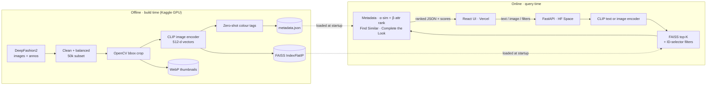

# Lookbook — AI-Powered Fashion Visual Search & Recommendation

Search a fashion catalogue **by description or by photo**. Text and images are embedded with
**OpenAI CLIP ViT-B/32** into one 512-d space alongside ~50,000 **DeepFashion2** garment crops,
and a **FAISS** index returns the nearest items in milliseconds. On top of retrieval: category
and attribute filters, a blended ranking score, **Find Similar** and **Complete the Look**.

> OJT project · Polaris School of Technology · Multimodal AI track
> Tanzila Tahreem (ms240410700021) · Mentor: Chennaveer Jogur · PRD v2.0

| | |
|---|---|
| **Frontend** | React 18 + Vite + Tailwind CSS + Axios → Vercel |
| **Backend** | FastAPI + Uvicorn, Dockerized → Hugging Face Spaces |
| **Model** | CLIP ViT-B/32, OpenAI weights via `open_clip` (`ViT-B-32-quickgelu`), CPU inference |
| **Vector search** | FAISS `IndexFlatIP` over L2-normalised vectors (exact cosine) |
| **Data** | DeepFashion2 (Kaggle mirror `thusharanair/deepfashion2-original-with-dataframes`) |
| **Tests** | 52 backend + 3 real-CLIP + 13 pipeline (pytest) · 11 frontend (Vitest + RTL) |

---

## Architecture



More detail, including the module design and request sequence, is in [docs/ARCHITECTURE.md](docs/ARCHITECTURE.md).

## Repository layout

```
ml/          offline pipeline (package `fvs_ml`) + Kaggle notebooks
  fvs_ml/    annotations · clean · subset · crop · embed · attributes · build_index · evaluate · pipeline
  notebooks/ 01_eda_cleaning.ipynb · 02_build_index_kaggle.ipynb
backend/     FastAPI service
  app/services/  EmbeddingService · IndexService · MetadataService · SearchService · RecommendationService
  app/api/       thin routes, error contract, rate limiting
  tests/         API + service tests (fake CLIP, synthetic index) and opt-in real-CLIP tests
frontend/    React app: search, item detail, about + evaluation dashboard, optional login
docs/        architecture, API, evaluation, deployment
deploy/      Hugging Face Space config
```

## Quick start (local)

Requirements: Python 3.11, Node 20+.

```bash
make setup                      # venv + Python deps + npm install

# Option 1 — real data: download the Kaggle notebook output (see "Building the index")
#            and extract it into backend/artifacts/
# Option 2 — plumbing check without the dataset:
make smoke-data && make dev-index

make dev-api                    # http://localhost:8000  (docs at /docs)
make dev-web                    # http://localhost:5173
```

Or run the full stack in containers: `docker compose up --build`.

> **macOS note:** the `faiss-cpu` and `torch` wheels each ship their own OpenMP runtime. On macOS
> both packages import `_platform.py` first: it loads torch before faiss and runs FAISS
> single-threaded, which avoids a segfault. Linux is unaffected.

## Building the index (real DeepFashion2)

The heavy step runs once, on Kaggle's free GPU, where the dataset already lives:

1. Push this repo to GitHub and set `REPO_URL` in `ml/notebooks/02_build_index_kaggle.ipynb`.
2. On Kaggle, create a notebook from that file, set **GPU** and **Internet on**, and add the input
   `thusharanair/deepfashion2-original-with-dataframes`.
3. Run all cells (about 30–60 min). The embedding step checkpoints in shards and resumes if interrupted.
4. Either download `fvs_artifacts.tar` into `backend/artifacts/`, or push it to a **private**
   Hugging Face dataset repo (last cell) for deployment.

You can also run the CLI anywhere: `python -m fvs_ml.pipeline --dataset-root <df2> --output-dir <out> --target-items 50000`.

## API

| Method & path | Purpose |
|---|---|
| `POST /search/text` | Natural-language search: `{query, top_k?, filters?, alpha?, beta?}` |
| `POST /search/image` | Multipart image search (`file`, `top_k`, `filters` JSON, `alpha`, `beta`) |
| `GET /items/{id}` | Item detail |
| `GET /items/{id}/similar` | Find Similar (source excluded) |
| `GET /items/{id}/recommendations` | Complete the Look, grouped, each item with a reason |
| `GET /filters` | Filter vocabulary with counts |
| `GET /images/{id}` | Garment thumbnail |
| `GET /health` | `status, model_loaded, index_loaded, item_count` + request stats |
| `GET /evaluation` | Offline evaluation report + manifest |
| `POST /auth/login` · `/auth/logout` · `GET /auth/me` | Optional demo session (`AUTH_ENABLED`) |

Errors always return `{"error": {"code", "message"}}`: 400 for an empty query, bad filter or bad
file type; 413 for an oversized upload; 404 for an unknown id; 422 for a schema violation; 429 when
rate-limited; 503 while the index loads; 500 with a safe message. Full reference: [docs/API.md](docs/API.md).

## Ranking & recommendations

* **Score:** `final = α · cosine + β · attribute_match` (defaults α 0.85, β 0.15, adjustable in the UI).
  Attributes are the category and colour words found in the query, or zero-shot CLIP guesses for an uploaded photo.
* **Find Similar:** FAISS neighbours of the item's own stored vector, with the item itself removed.
* **Complete the Look:** the item's category maps to compatible groups
  ([compatibility.json](backend/app/data/compatibility.json)), and retrieval is restricted to those categories.
  Garments photographed together in DeepFashion2 are pinned first as real outfit evidence.

## Evaluation

`evaluate.py` reports consumer→shop **Recall@1/5/10** using the DeepFashion2 pair+style protocol
on a held-out validation slice, against a same-category baseline. It also reports text→category
**Precision@K** against a keyword baseline, a Complete-the-Look co-occurrence hit rate, latency and
footprint. The About page renders the report. Method and caveats: [docs/EVALUATION.md](docs/EVALUATION.md).

## Deviations from the PRD (and why)

| PRD | Implemented | Reason |
|---|---|---|
| Backend on Render | Hugging Face Spaces (Docker) | Render free/Starter have 512 MB RAM; CLIP + index need ~1–1.5 GB. Spaces' free tier has 16 GB. Same Dockerfile. |
| "dress → shoes, bag" | dress → outerwear, top → bottoms/outerwear, … | DeepFashion2 has no shoes or bags. |
| Colour attribute | Inferred zero-shot with CLIP at index time | DeepFashion2 has no colour labels. |
| `ViT-B/32` | `open_clip` name `ViT-B-32-quickgelu`, `pretrained="openai"` | Same OpenAI model; the `-quickgelu` config matches the activation those weights were trained with. |

## Licensing

DeepFashion2 is used under its academic research terms. Raw dataset assets are never committed
or redistributed. The index artifacts live in a private repo, and the demo serves only derived
garment thumbnails.
