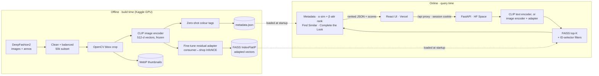

# Lookbook — AI-Powered Fashion Visual Search & Recommendation

Search a fashion catalogue **by description or by photo**. Text and images are embedded with
**OpenAI CLIP ViT-B/32** into one 512-d space alongside ~50,000 **DeepFashion2** garment crops,
and a **FAISS** index returns the nearest items in milliseconds. A small **residual adapter,
fine-tuned on DeepFashion2 consumer↔shop pairs**, specialises the frozen CLIP image space for
street-photo→shop matching. On top of retrieval: category and attribute filters, a blended
ranking score, **Find Similar** and **Complete the Look**. The app has a landing page, real
user accounts (sign up / sign in) and four switchable themes.

> OJT project · Polaris School of Technology · Multimodal AI track
> Tanzila Tahreem (ms240410700021) · Mentor: Chennaveer Jogur · PRD v2.0

| | |
|---|---|
| **Frontend** | React 18 + Vite + Tailwind CSS + Axios → Vercel. Landing page, auth pages, app; 4 themes (Atelier, Midnight, Blush, Noir) |
| **Backend** | FastAPI + Uvicorn, Dockerized → Hugging Face Spaces. SQLite accounts (scrypt hashes, signed cookies) |
| **Model** | CLIP ViT-B/32, OpenAI weights via `open_clip` (`ViT-B-32-quickgelu`), frozen; + fine-tuned residual adapter (numpy at serve time) |
| **Vector search** | FAISS `IndexFlatIP` over L2-normalised vectors (exact cosine) |
| **Data** | DeepFashion2 (Kaggle mirror `thusharanair/deepfashion2-original-with-dataframes`) |
| **Training / indexing** | Kaggle T4 GPU, driven from this repo through the Kaggle API (`make kaggle-build`) |
| **Tests** | 72 backend + 3 real-CLIP + 18 pipeline (pytest) · 21 frontend (Vitest + RTL) |

---

## Architecture



More detail, including the module design and request sequence, is in [docs/ARCHITECTURE.md](docs/ARCHITECTURE.md).

## Repository layout

```
ml/          offline pipeline (package `fvs_ml`) + Kaggle notebooks + Kaggle API runner
  fvs_ml/    annotations · clean · subset · crop · embed · attributes · finetune · build_index · evaluate · pipeline
  kaggle/    run_kaggle.py (push / status / download) + kernel_template.py (self-contained GPU build)
  notebooks/ 01_eda_cleaning.ipynb · 02_build_index_kaggle.ipynb
backend/     FastAPI service
  app/services/  EmbeddingService · Adapter · IndexService · MetadataService · SearchService ·
                 RecommendationService · UserStore
  app/api/       thin routes, error contract, rate limiting, auth
  tests/         API, auth + service tests (fake CLIP, synthetic index) and opt-in real-CLIP tests
frontend/    React app: landing page → sign in / sign up → search, item detail, insights dashboard
  src/theme/     theme registry; colours are CSS variables per theme (src/index.css)
docs/        architecture, API, evaluation, deployment
deploy/      Hugging Face Space config
```

## Quick start (local)

Requirements: Python 3.11, Node 20+.

```bash
make setup                      # venv + Python deps + npm install

# Option 1 — real data: download the Kaggle notebook output (see "Building the index")
#            and extract it into backend/artifacts/
# Option 2 — plumbing check without the dataset:
make smoke-data && make dev-index

make dev-api                    # http://localhost:8000  (docs at /docs)
make dev-web                    # http://localhost:5173  ← open this
```

Open http://localhost:5173: the landing page → **Get started** → create an account → the app.
The browser talks to the API through Vite's `/api` proxy, so the session cookie is first-party.
Accounts are stored in `backend/data/users.db` (git-ignored). Change themes from the palette
button in the header.

Or run the full stack in containers: `docker compose up --build`.

> **macOS note:** the `faiss-cpu` and `torch` wheels each ship their own OpenMP runtime. On macOS
> both packages import `_platform.py` first: it loads torch before faiss and runs FAISS
> single-threaded, which avoids a segfault. Linux is unaffected.

## Building the index (real DeepFashion2)

The heavy step runs once, on Kaggle's free T4 GPU, where the dataset already lives. It is driven
from this repo through the Kaggle API; no GitHub push or manual notebook is needed:

```bash
.venv/bin/pip install -e "ml[kaggle]"      # Kaggle CLI
# put your Kaggle API token in ~/.kaggle/access_token (chmod 600); the account must be phone-verified
make kaggle-build      # bundles fvs_ml into one private script kernel and starts it (~1–1.5 h)
make kaggle-status     # queued / running / complete / error
make kaggle-download   # extracts index.faiss, metadata.json, adapter.npz, images/ … into backend/artifacts/
```

The kernel builds the 50k catalogue, fine-tunes the adapter (`--finetune`) and writes the
evaluation report, including the pretrained-vs-fine-tuned ablation. Restart `make dev-api` to
serve it. The notebook `ml/notebooks/02_build_index_kaggle.ipynb` is the same build in a manual
form. The CLI also runs anywhere:
`python -m fvs_ml.pipeline --dataset-root <df2> --output-dir <out> --target-items 50000 --finetune`.

## API

| Method & path | Purpose |
|---|---|
| `POST /search/text` | Natural-language search: `{query, top_k?, filters?, alpha?, beta?}` |
| `POST /search/image` | Multipart image search (`file`, `top_k`, `filters` JSON, `alpha`, `beta`) |
| `GET /items/{id}` | Item detail |
| `GET /items/{id}/similar` | Find Similar (source excluded) |
| `GET /items/{id}/recommendations` | Complete the Look, grouped, each item with a reason |
| `GET /filters` | Filter vocabulary with counts |
| `GET /images/{id}` | Garment thumbnail |
| `GET /health` | `status, model_loaded, index_loaded, item_count` + request stats |
| `GET /evaluation` | Offline evaluation report (incl. fine-tuning ablation) + manifest |
| `GET /showcase` | Category-diverse public sample for the landing page |
| `POST /auth/register` · `/auth/login` · `/auth/logout` · `GET /auth/me` | Accounts and sessions; `/search/*` and `/items/*` require a session |

Errors always return `{"error": {"code", "message"}}`: 400 for an empty query, bad filter, bad
file type or weak password; 401 without a session; 409 for a taken email; 413 for an oversized
upload; 404 for an unknown id; 422 for a schema violation; 429 when rate-limited; 503 while the
index loads; 500 with a safe message. Full reference: [docs/API.md](docs/API.md).

## Fine-tuning (the training component)

CLIP is trained on web captions, not on matching a street photo of a garment to its shop photo.
`ml/fvs_ml/finetune.py` keeps the CLIP backbone **frozen** and trains a residual
**CLIP-Adapter** (512→256→512, GELU) on the image embeddings:

* **Data:** consumer↔shop pairs mined from the DeepFashion2 **train** split (same `pair_id` and
  `style`, ≤ 60k items); 10 % of pair ids are held out for early stopping and choosing the
  residual ratio `r`. The evaluation slice (validation) is never touched.
* **Loss:** symmetric InfoNCE between consumer and shop views (in-batch negatives, learnable
  temperature) **+ λ · cross-entropy against frozen CLIP text prototypes** of the 13 categories,
  so image vectors stay aligned with the text space and text search keeps working.
* **Selection:** `r` is grid-searched on the tuning split, maximising Recall@10 under a
  ≤ 2-point text-precision drop. If `r = 0` wins, the build serves pretrained CLIP.
* **Serving:** `adapter.npz` is applied in numpy (two matmuls) to query images; the index already
  stores adapted vectors. The Insights page shows pretrained vs fine-tuned Recall@K, the loss
  and validation curves, and the `r` search.

## Accounts & themes

* `POST /auth/register` creates an account in SQLite (`USERS_DB_PATH`). Passwords are hashed with
  stdlib `hashlib.scrypt` (random salt) and verified in constant time; login responses don't
  reveal whether an email exists. Sessions are HMAC-signed, expiring, HttpOnly cookies.
* The frontend calls `/api/*`: Vite proxies it locally and a Vercel rewrite proxies it in
  production. The cookie is therefore first-party (`SameSite=Lax`) and works in Safari, which
  blocks third-party cookies.
* Themes are pure CSS variables on `<html data-theme>`. The choice is remembered and applied
  before first paint. Each theme's two chart colours were validated for lightness, chroma,
  colour-blind separation and contrast against that theme's surface.

## Ranking & recommendations

* **Score:** `final = α · cosine + β · attribute_match` (defaults α 0.85, β 0.15, adjustable in the UI).
  Attributes are the category and colour words found in the query, or zero-shot CLIP guesses for an uploaded photo.
* **Find Similar:** FAISS neighbours of the item's own stored vector, with the item itself removed.
* **Complete the Look:** the item's category maps to compatible groups
  ([compatibility.json](backend/app/data/compatibility.json)), and retrieval is restricted to those categories.
  Garments photographed together in DeepFashion2 are pinned first as real outfit evidence.

## Evaluation

`evaluate.py` reports consumer→shop **Recall@1/5/10** using the DeepFashion2 pair+style protocol
on a held-out validation slice, against a same-category baseline and against pretrained CLIP
(the fine-tuning ablation). It also reports text→category **Precision@K** against a keyword
baseline, a Complete-the-Look co-occurrence hit rate, latency and footprint. The Insights page
renders the report. Method and caveats: [docs/EVALUATION.md](docs/EVALUATION.md).

## Deviations from the PRD (and why)

| PRD | Implemented | Reason |
|---|---|---|
| Backend on Render | Hugging Face Spaces (Docker) | Render free/Starter have 512 MB RAM; CLIP + index need ~1–1.5 GB. Spaces' free tier has 16 GB. Same Dockerfile. |
| "dress → shoes, bag" | dress → outerwear, top → bottoms/outerwear, … | DeepFashion2 has no shoes or bags. |
| Colour attribute | Inferred zero-shot with CLIP at index time | DeepFashion2 has no colour labels. |
| `ViT-B/32` | `open_clip` name `ViT-B-32-quickgelu`, `pretrained="openai"` | Same OpenAI model; the `-quickgelu` config matches the activation those weights were trained with. |
| Pretrained CLIP only | Frozen CLIP + fine-tuned residual adapter (ablation reported) | Adds a measured training component without retraining the backbone; falls back to pretrained if it doesn't help. |
| "Basic session login" (Could Have) | Real accounts: register / sign in, SQLite + scrypt | Requested for the landing → auth → app flow. |

## Licensing

DeepFashion2 is used under its academic research terms. Raw dataset assets are never committed
or redistributed. The index artifacts live in a private repo, and the demo serves only derived
garment thumbnails.
