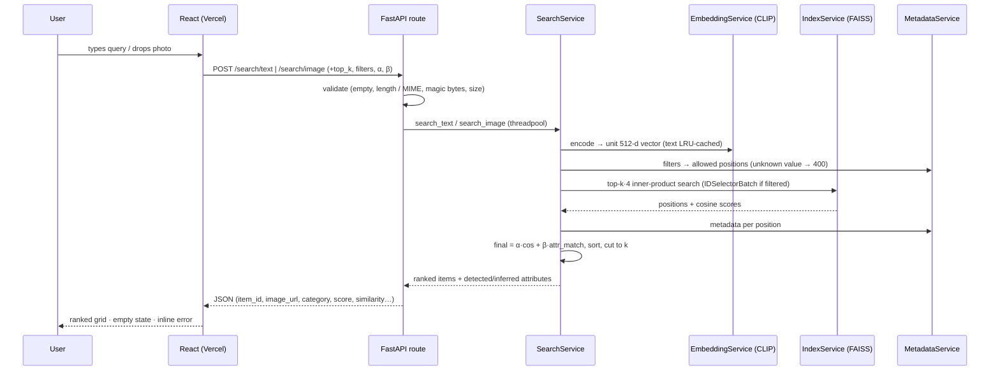

# Architecture

## Two paths

The **offline path** turns DeepFashion2 into a searchable index. It runs once per catalogue
version, on Kaggle. The **online path** answers queries against that prebuilt index. Startup is
load-only: the container never rebuilds the index, and a redeploy cannot lose it.

### Offline pipeline (`ml/fvs_ml/pipeline.py`)

| Step | Module | What happens |
|---|---|---|
| 1. Load | `annotations.py` | Every `itemN` in every per-image JSON → one row keyed by `split + image_id + N`; paths stay split-relative |
| 2. Clean | `clean.py` | Dedupe on `item_id`, drop missing essentials, unknown categories and boxes < 32 px. Keep occlusion, side views and consumer photos |
| 3. Hold out | `subset.py` | 25 % of validation **pairs** (capped at 4k images) → evaluation slice, never indexed |
| 4. Sample | `subset.py` | Category-balanced 50k subset; water-filling gives rare classes' unused quota to larger ones |
| 5. Crop + encode | `crop.py`, `embed.py` | OpenCV bbox crop (+6 % padding) → CLIP image encoder in batches; 5k-item shards checkpointed as `.npy` (resumable); WebP thumbnails written in the same pass |
| 6. Colour | `attributes.py` | Zero-shot: cosine to prompt-ensembled colour prototypes, softmax; < 0.35 confidence → `multicolour` |
| 7. Index | `build_index.py` | L2-normalise → `IndexFlatIP`; `metadata.json` position-aligned with the index, including `worn_with` (other items in the same photo) |
| 8. Evaluate | `evaluate.py` | See [EVALUATION.md](EVALUATION.md) |

### Online request sequence

## Backend modules (PRD §9.1)

| Module | Responsibility | Never does |
|---|---|---|
| `EmbeddingService` | Wraps an `Encoder` (CLIP or test fake); unit-norm text/image vectors; zero-shot prototypes | search or ranking |
| `IndexService` | FAISS search (optionally restricted with an ID selector) and vector reconstruction | metadata |
| `MetadataService` | position ⇄ item, filter vocabulary, filter → positions; detects index/lookup drift at load | similarity |
| `SearchService` | embed → retrieve → metadata → filter → rank; owns final ordering | HTTP concerns |
| `RecommendationService` | Find Similar; Complete the Look via `CompatibilityMap`; a reason per item | encoding |
| `api/routes/*` | validation, threadpool hand-off, JSON shaping | model or index logic |

`container.py` wires these together once at startup. If the artifacts are missing or broken, the app
still starts: `/health` reports `degraded` and search returns 503 instead of the process crash-looping.

## Key decisions

* **Exact search (`IndexFlatIP`).** At 50k × 512 floats (~100 MB) a flat scan takes milliseconds
  and recall is exact. IVF/HNSW only becomes worthwhile at a much larger corpus (stretch goal).
* **Filtered search inside FAISS.** `IDSelectorBatch` keeps filtered queries exact. Post-filtering
  a fixed top-k could return too few items for rare filter combinations.
* **Over-fetch then re-rank.** When the attribute signal is active, `k × 4` candidates are fetched
  so an exact category/colour match just outside the raw top-k can rise.
* **No database.** The catalogue is a static, read-only artifact and the app stores no user
  records, so JSON + FAISS files are simpler and cheaper than PostgreSQL or MongoDB (PRD §6).
* **CPU inference.** One ViT-B/32 forward pass is ~10–40 ms on CPU, far inside the 2 s / 4 s budget.

## Security (PRD §11)

* Text: non-empty and ≤ 200 characters. Uploads: MIME allow-list, `Content-Length` pre-check,
  streamed size cap (413), magic-byte check, Pillow decompression-bomb guard. All checks run
  before decoding.
* CORS is restricted to `ALLOWED_ORIGINS`; HTTPS is provided by Vercel and Spaces.
* Item IDs are validated by regex and checked against the catalogue before any file access,
  so path traversal is impossible.
* Exceptions are logged server-side and returned as a generic 500. No paths are ever serialised.
* `slowapi` rate-limits search (default 60/min/IP) and login (10/min/IP).
* Optional login uses an HMAC-signed, expiring, HttpOnly cookie (`itsdangerous`) with
  constant-time credential comparison.
* Uploads are processed in memory and dropped. Logs record path, status and latency only,
  never queries or images.
